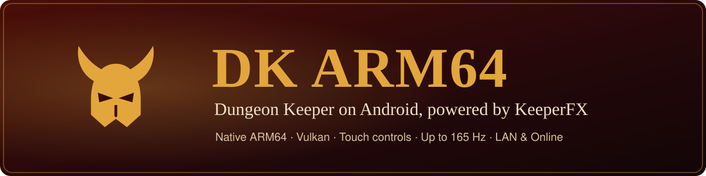
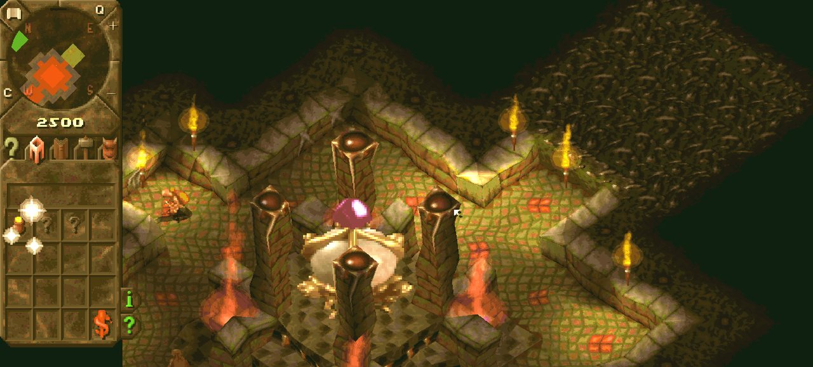
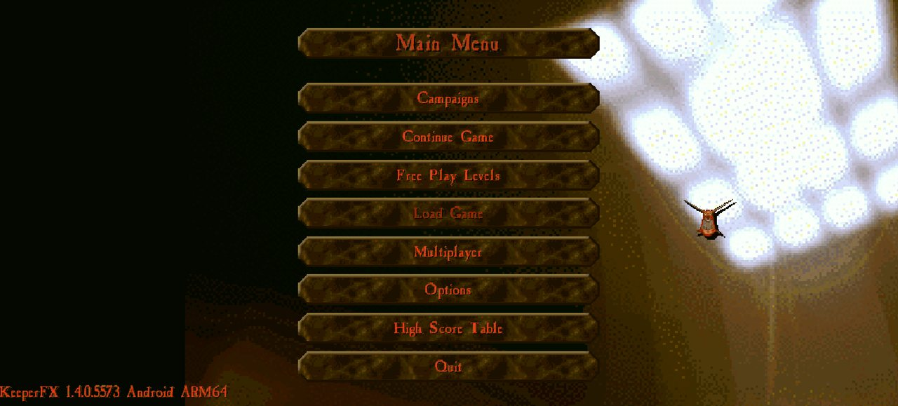
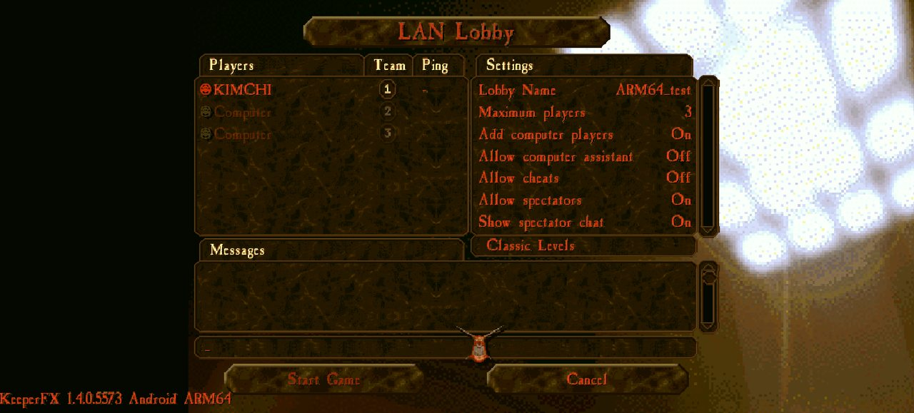
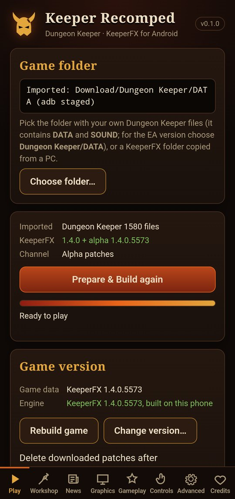
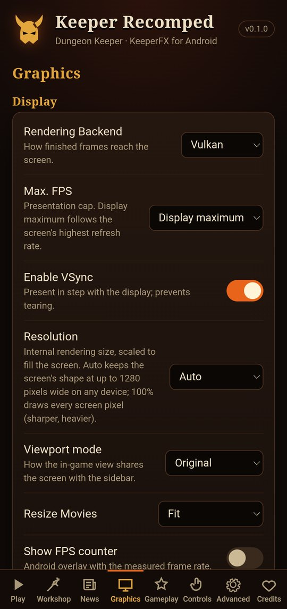
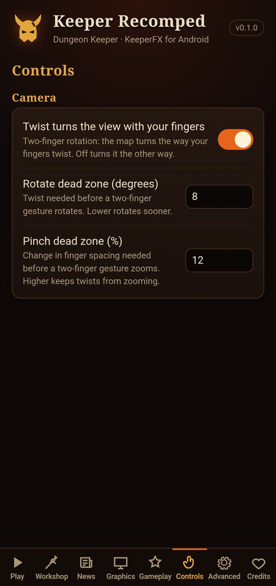
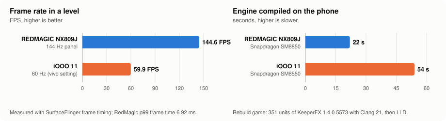
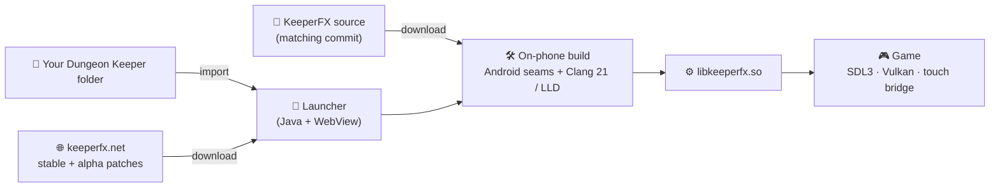

<p align="center">
  
</p>

<p align="center">
  <a href="https://github.com/K11MCH1/DK-ARM64/releases/latest"></a>
  
  
  
  <a href="https://keeperfx.net"></a>
  <a href="LICENSE"></a>
</p>

> [!IMPORTANT]
> **Unofficial fan project.** DK ARM64 is not affiliated with or endorsed by Electronic Arts, Bullfrog Productions or the KeeperFX team. It contains **no game data**: you need your own copy of Dungeon Keeper (GOG, EA app or the original CD).

## 🏰 What it is

**DK ARM64** brings Dungeon Keeper to Android phones. It runs [KeeperFX](https://keeperfx.net), the open-source remake of the Dungeon Keeper engine, compiled **natively for ARM64**: no emulator, no DOSBox. Frames reach the screen through **Vulkan**, the game is played with **touch controls** made for it, and a launcher app does the whole setup: it imports your Dungeon Keeper files, downloads KeeperFX, and compiles the game engine **on the phone itself**.

The app installs as **Keeper Recomped**.

| | |
|---|---|
| 📱 **Native ARM64** | KeeperFX's C/C++ engine built for `arm64-v8a` (Android 15+, API 35). |
| 🎞️ **Vulkan, up to 165 Hz** | Presented through SDL3 on Vulkan (OpenGL ES fallback) at your screen's highest refresh rate. 144 FPS measured. |
| 👆 **Touch controls** | Tap, hold, pinch, twist, double-tap dig boxes, an on-screen stick for possession, and more. |
| 🛠️ **Engine compiled on the phone** | Pick any KeeperFX version (stable or alpha) and the phone builds the matching engine in 20–60 s. |
| 🌐 **Multiplayer** | LAN between phones and Online through KeeperFX matchmaking, cross-play with PC verified. |
| 🧩 **Workshop and News** | Browse keeperfx.net news and install Workshop maps from the launcher. |

## 📸 Screenshots

<table>
  <tr>
    <td></td>
    <td></td>
  </tr>
  <tr>
    <td></td>
    <td></td>
  </tr>
</table>

<table>
  <tr>
    <td align="center"><br><sub>Play: import, Prepare &amp; Build, game version</sub></td>
    <td align="center"><br><sub>Graphics: Vulkan, frame rate, resolution</sub></td>
    <td align="center"><br><sub>Controls: twist direction, dead zones</sub></td>
  </tr>
</table>

## ⚡ Performance

Measured on two phones with KeeperFX 1.4.0.5573 (game frame timing from Android's SurfaceFlinger, engine builds from the launcher log).

<picture>
  <source media="(prefers-color-scheme: dark)" srcset="docs/images/performance-dark.svg">
  
</picture>

| | 🔴 REDMAGIC NX809J | 🔵 iQOO 11 (V2243A) |
|---|---|---|
| **Chip / RAM** | Snapdragon SM8850 (8 Elite Gen 5) · 24 GB | Snapdragon SM8550 (8 Gen 2) · 16 GB |
| **Android** | 16 | 16 |
| **Frame rate in a level** | **144.6 FPS** at 144 Hz, steady while panning | **59.9 FPS** at 60 Hz ¹ |
| **Frame time** | p50 / p99 **6.92 ms**, no dropped frames | 16.7 ms average |
| **Engine compiled on the phone** | **22 s** (8 cores, -O2) | **54 s** |
| **First setup (Prepare &amp; Build)** | 33 s when the data is already current | **2.5 min** from scratch, downloads included |
| **Multiplayer** | LAN host for the iQOO, no desync through turn 2833 | Online client of a Windows PC host, no desync through turn 2218 |

¹ The iQOO's panel goes to 144 Hz and the game asks for it, but vivo keeps games that are not on its own list at 60 Hz. That is a phone setting, not a limit of the port. On the REDMAGIC, 144 Hz is set per game in Game Space.

## 🧠 How it works



- **Native engine.** KeeperFX is compiled with the Android NDK (r27, API 35). Its version-independent libraries (curl, OpenSSL, ENet, FFmpeg, OpenAL, Lua and others, from vcpkg) are linked once on the PC into a single library, `libkrdeps.so`, next to SDL3's own, so the phone only compiles the game itself.
- **Small, portable changes.** The Android support is a list of small source "seams" (`#ifdef KFX_ANDROID`) for touch input, camera, presentation, file paths and TLS certificates. They are applied to whichever KeeperFX version you choose, so new KeeperFX alphas work without an app update.
- **A compiler inside the APK.** Clang 21 and LLD (Termux builds) ship with the app. **Rebuild game** downloads the KeeperFX source for the installed version, applies the seams and compiles about 350 source files on the phone's own cores.
- **Presentation.** KeeperFX renders its frames in software. SDL3 puts them on screen through Vulkan (or OpenGL ES) at the panel's highest refresh rate, up to 165 Hz.
- **Touch bridge.** A gesture recognizer turns touches into the mouse, keyboard and camera input KeeperFX expects. While you possess a creature, a separate controller with its own on-screen overlay takes over.
- **No Gradle.** The APK is assembled by one Python script: `javac → d8 → aapt2 → zipalign → apksigner`.

More detail: [docs/LAUNCHER.md](docs/LAUNCHER.md) (launcher and controls), [docs/PORT_STATUS.md](docs/PORT_STATUS.md) (engine port) and [docs/HANDOFF.md](docs/HANDOFF.md) (development log with every measurement).

## 📦 What you need

**To play**
- An **ARM64 phone with Android 15 or newer**. A 120 Hz or faster screen is recommended.
- About **1.5 GB of free storage**: KeeperFX ~600 MB, your game files ~350 MB, plus the engine toolchain.
- **Your own Dungeon Keeper files**: the folder that holds `DATA` and `SOUND` (for the EA app version, `Dungeon Keeper/DATA`).
- **An internet connection** for the first setup (KeeperFX from keeperfx.net, engine source from GitHub).

**Install**
1. Download the APK from [Releases](https://github.com/K11MCH1/DK-ARM64/releases/latest) and install it (allow installs from your browser or file manager).
2. Copy your Dungeon Keeper folder to the phone, for example into `Download/`.
3. Open **Keeper Recomped** → **Play** → **Choose folder…** and pick it.
4. Tap **Prepare & Build**. It downloads and installs KeeperFX, then compiles the engine on the phone.
5. Tap **Play**.

**To build it yourself** (Windows): JDK 17, Android SDK (platform 35, build-tools 35.0.0), NDK 27.3, CMake 3.22, Python 3.13 and vcpkg.

```powershell
powershell -File tools/build-dependencies.ps1     # vcpkg libraries for arm64-android
powershell -File tools/build-native.ps1           # KeeperFX + Android layer -> build/android/native
python scripts/android/engine_kit.py              # libkrdeps.so + the on-phone engine kit
python scripts/android/build_apk.py --output build/apk/dk-arm64.apk
```

The on-phone compiler comes from verified Termux packages (`build_apk.py --compiler-packages / --compiler-manifest`, see `--help`).

KeeperFX is pinned in [`third_party.lock.json`](third_party.lock.json) and patched by [`tools/patch-keeperfx.py`](tools/patch-keeperfx.py).

## ✨ Not in KeeperFX: what this port adds

| Area | Added for Android |
|---|---|
| 🚀 **Launcher** | Eight tabs (Play, Workshop, News, Graphics, Gameplay, Controls, Advanced, Credits); imports your game folder through Android's folder picker; downloads and installs KeeperFX stable and alpha patches; writes `keeperfx.cfg` from the settings |
| 🛠️ **On-phone engine** | Rebuild game for the installed KeeperFX version; version picker (any alpha, or back to stable); a warning when game data and engine don't match; optional removal of downloaded patches |
| 👆 **Touch controls** | Tap = click; tap & hold = hold; two-finger tap = right click / slap; drag pans; pinch zooms; twist rotates (direction and dead zones adjustable); double-tap & hold drags a dig box; hold a creature-panel count to keep grabbing; two-finger hold drops everything in the hand |
| 🕹️ **Possession** | On-screen analog stick (8 directions, walk or run), drag to look, attack and exit buttons, tappable spell panel |
| 🗺️ **Camera** | Map keeps your zoom; tapping a place straightens the view like on PC |
| 👀 **Spectating** | Touch moves the spectator camera; two-finger tap returns to the watched player |
| 💬 **Lobbies** | Keyboard only when you tap the chat line or a text box |
| 🎞️ **Display** | Vulkan presentation at the panel's maximum refresh (up to 165 Hz), OpenGL ES fallback, render scale, FPS overlay |
| 🌐 **Online** | Matchmaking over TLS using the phone's certificate store |
| 🏛️ **Play Original** | The KeeperFX classic profile: original campaign only, no mods, separate saves |

## 🙏 Credits

- **K11MCH1**: the project.
- **Bullfrog Productions**: *Dungeon Keeper* (1997), published by Electronic Arts.
- **The KeeperFX team and contributors**: the engine, its data packs, keeperfx.net and the matchmaking service ([dkfans/keeperfx](https://github.com/dkfans/keeperfx)).
- **Open-source components**: [SDL3](https://libsdl.org) with SDL_image and SDL_mixer, [LLVM / Clang / LLD](https://llvm.org) (as packaged by [Termux](https://termux.dev)), the Android NDK, [vcpkg](https://vcpkg.io), curl, OpenSSL, ENet, FFmpeg, OpenAL Soft, Lua 5.1 with LuaBitOp, fmt, libpng, libspng, libjpeg-turbo, libogg, libvorbis, zlib, minizip, miniupnpc, libnatpmp, Astronomy Engine, and the LZMA SDK (7-Zip) by Igor Pavlov.

## 📄 License

- DK ARM64 is free software under the **GNU General Public License v2.0 or later** ([LICENSE](LICENSE)), the same license as KeeperFX.
- Bundled third-party components keep their own licenses. Their full texts ship inside the app (Credits tab); the engine libraries' texts are also in [`android/game/assets/licenses`](android/game/assets/licenses).
- *Dungeon Keeper* is © Electronic Arts. All trademarks belong to their owners. No original game files are included or distributed here.
